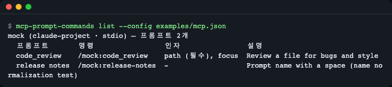
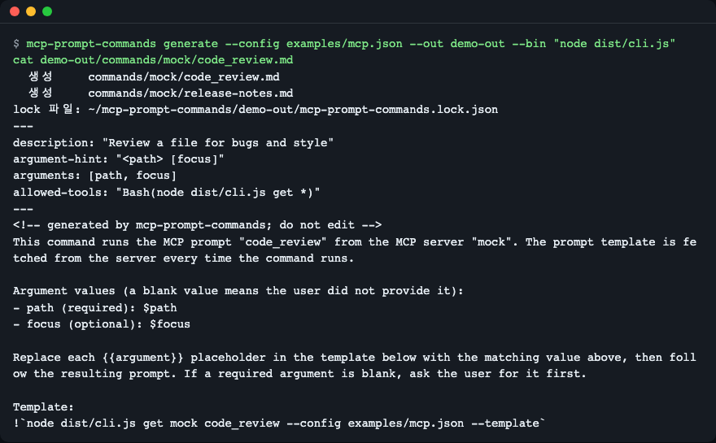
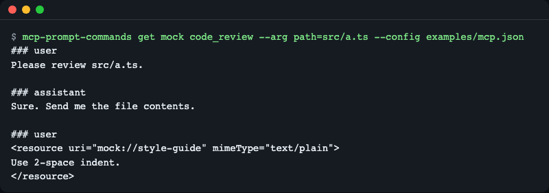
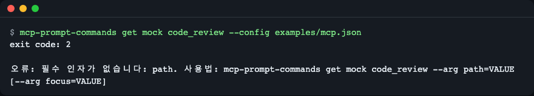
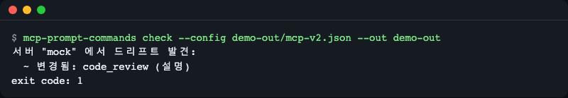
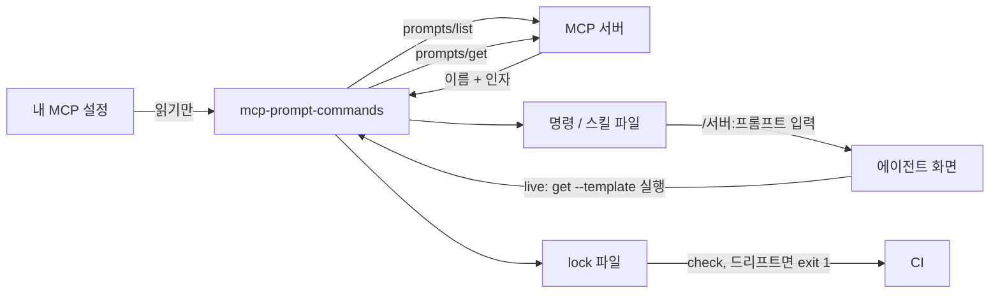

# mcp-prompt-commands

[English](README.md) | **한국어**

MCP 서버의 프롬프트를 슬래시 명령(또는 스킬) 파일로 만들어, `/` 메뉴에 MCP 프롬프트를 보여 주지 않는 에이전트 화면에서도 쓰게 해 주는 CLI입니다. MCP 서버는 미리 만들어 둔 프롬프트 템플릿("prompts" 기본 요소)을 제공할 수 있습니다. 이 도구는 이미 있는 MCP 설정을 읽어 각 서버에 프롬프트를 물어보고, 프롬프트마다 `/서버:프롬프트` 파일 하나를 만들며, lock 파일과 CI용 드리프트 검사도 제공합니다.


*`list` 는 서버에 프롬프트를 물어보고, 각 프롬프트가 받을 슬래시 명령과 필수 인자를 표시합니다.*

## 이런 분께

- Claude Code 를 VS Code 확장·데스크톱 앱·WSL·원격 HTTP 서버로 쓰는데, 터미널에서는 보이던 MCP 프롬프트가 그 화면의 `/` 메뉴에는 없는 분
- MCP 서버를 만들고 있고, 명령 파일을 읽는 어떤 화면에서든 사용자가 프롬프트를 바로 쓰게 하고 싶은 분
- 명령 파일을 만든 뒤 서버의 프롬프트가 바뀌면 CI 가 실패하게 하고 싶은 분

## 설치

Node.js 20 이상이 필요합니다(`brew install node`, 또는 https://nodejs.org). 최소 리눅스 이미지에서는 `git` 과 `ca-certificates` 도 설치하세요.

```bash
npm install -g mcp-prompt-commands      # 이후 실행: mcp-prompt-commands --help
npx mcp-prompt-commands list            # 설치 없이 실행
```

저장소를 clone 해서 쓰는 방법(아래 예시는 이 방법으로 실행했습니다):

```bash
git clone https://github.com/LeeGyeongPil/mcp-prompt-commands.git
cd mcp-prompt-commands
npm ci && npm run build
node dist/cli.js --version
```
```text
0.1.1
```

`npx` 는 매번 새 Node 프로세스를 띄우므로 캐시가 없으면 몇 초가 더 걸립니다. 아래 `live` 모드에는 전역 설치를 권합니다.

## 빠르게 시작하기 (연습용 목 서버)

저장소에는 **연습용 목(mock) MCP 서버**가 들어 있습니다. 가짜 글자만 찍는 것이 아니라 실제 MCP 프로토콜(stdio)로 통신하지만, 직접 만든 프롬프트 2개만 제공하므로 계정·키·네트워크가 필요 없습니다. 실제 서버와 다른 점은, 실제 서버는 내 프롬프트를 가진 내 서버이고 기동이 더 느릴 수 있다는 것입니다(`npx` 기반·원격 서버 등).

```bash
npm ci && npm run demo
```
```text
Practice (mock) mode: using the bundled mock MCP server, not a real one.

$ mcp-prompt-commands list --config examples/mcp.json   # 1. which prompts does the server offer?
mock (claude-project · stdio) — 2 prompt(s)
  PROMPT         COMMAND              ARGUMENTS               DESCRIPTION
  code_review    /mock:code_review    path (required), focus  Review a file for bugs and style
  release notes  /mock:release-notes  -                       Prompt name with a space (name normalization test)

$ mcp-prompt-commands generate --config examples/mcp.json --out demo-out --bin "node dist/cli.js"   # 2. write one command file per prompt (live mode)
  created    commands/mock/code_review.md
  created    commands/mock/release-notes.md
Lock file: <repo>/demo-out/mcp-prompt-commands.lock.json
```

데모는 이어서 생성된 파일을 출력하고, `get` 으로 프롬프트를 렌더링하고, `check` 로 끝납니다(`Checked 2 prompt(s) on 1 server(s): no drift.`). 약 3초 걸립니다. 생성 파일은 git 에서 제외되는 `demo-out/` 에 쓰입니다. 데모 안내 글은 영어로 나오며, `MCP_PROMPT_COMMANDS_LANG=ko npm run demo` 로 도구 출력을 한국어로 볼 수 있습니다.

## 단계별 따라 하기

### 1. 서버가 무엇을 제공하는지 보기 (`list`)


*한 줄이 MCP 프롬프트 하나입니다. `path (필수)` 는 서버가 그 인자를 필수로 표시했다는 뜻입니다.*

MCP 프롬프트는 이름, 선택적 설명, 인자 목록으로 이루어집니다. 클라이언트는 `prompts/list` 로 목록을 묻고 `prompts/get` 으로 하나를 받아 옵니다. 큰 서버는 목록을 나눠 주는데, 이 도구는 `nextCursor` 페이지를 끝까지 따라가 전부 모읍니다.

### 2. 명령 파일 만들기 (`generate`)


*서버의 인자 정의가 명령 파일의 프런트매터(`argument-hint`, `arguments`, `allowed-tools`)로 옮겨졌습니다.*

파일 읽는 법: 프런트매터가 인자를 선언하므로 에이전트 화면이 인자를 물어볼 수 있습니다. 본문은 사용자가 입력한 값(`$path`, `$focus`)을 셸 줄 **밖**에 나열합니다. 마지막 줄(`` !`…get mock code_review … --template` ``)은 명령을 실행할 때마다 서버에서 최신 템플릿을 가져옵니다. **사용자 인자는 셸 줄에 절대 들어가지 않으므로** `; rm -rf ~` 같은 값도 실행되지 않고 본문의 평범한 글자로 남습니다.

먼저 `--dry-run` 으로 파일을 건드리지 않고 무엇을 쓸지 볼 수 있습니다.

```bash
node dist/cli.js generate --config examples/mcp.json --out demo-out --bin "node dist/cli.js" --dry-run
```
```text
Dry run: nothing is written.
  unchanged  commands/mock/code_review.md
  unchanged  commands/mock/release-notes.md
```

(데모가 같은 파일을 이미 썼기 때문에 `unchanged` 입니다. `--bin` 없이 실행하면 파일 안의 명령이 `mcp-prompt-commands` 로 달라져 `updated` 로 나오고, 그 명령이 PATH 에 없으면 경고가 나옵니다. 위 출력은 `--lang en` 기준입니다.) 파일을 실제로 쓰는 방법은 아래 "내 서버에 적용하기"를 보세요.

### 3. 프롬프트 하나 받아 오기 (`get`)


*서버가 보낸 메시지를 역할별로 나눈 결과입니다. 내장 리소스(스타일 가이드)는 텍스트로 포함됩니다.*

`get` 은 생성된 파일이 실행하는 명령입니다. 믿고 쓰기 전에 직접 실행해 프롬프트를 확인할 수도 있습니다.

### 4. 필수 인자는 서버를 띄우기 전에 검사


*오류가 바로 나오고 종료 코드는 2 입니다. 잘못된 호출에는 서버를 띄우지 않습니다.*

없는 프롬프트는 종료 코드 3 과 서버의 메시지(`error: The server returned error -32602: Prompt nope not found`)가 나옵니다.

### 5. 드리프트 잡기 (`check`)


*`generate` 이후 서버의 `code_review` 설명이 바뀌었습니다(두 명령 사이에 목 서버 사본을 고쳤습니다). `check` 가 변경을 나열하고 종료 코드 1 로 끝납니다.*

## 내 서버에 적용하기

`--config` 없이 실행하면 이미 있는 MCP 설정을 읽습니다("설정" 참고). `npm install -g mcp-prompt-commands` 로 한 번 설치한 뒤, 프로젝트 폴더에서 다음 순서로 진행합니다.

1. 어떤 서버와 프롬프트가 보이는지 확인합니다.
   ```bash
   mcp-prompt-commands list
   ```
2. 파일을 씁니다.
   ```bash
   mcp-prompt-commands generate
   ```
   프로젝트 폴더 기준으로 다음이 쓰입니다.
   - `.claude/commands/<서버>/<프롬프트>.md`: 프롬프트마다 명령 파일 하나(`--format skills` 이면 `.claude/skills/<서버>-<프롬프트>/SKILL.md`, 스킬 이름은 Agent Skills 규격에 맞게 `_` 를 `-` 로 바꿈. 예전 밑줄 이름 스킬의 `SKILL.md` 는 생성된 그대로(수정 안 함)이면 다음 `generate` 때 삭제, 수정한 것은 유지)
   - `.claude/mcp-prompt-commands.lock.json`: `check` 가 비교하는 lock 파일
3. 에이전트 화면에서 프로젝트를 열고 `/<서버>:<프롬프트>` 를 입력합니다(예: `/docs:code_review`). 화면이 선언된 인자를 물어봅니다.

공백이 들어간 옵션 값은 따옴표로 묶어 값 하나로 넘겨야 합니다(예: `--bin "node dist/cli.js"`). 따옴표가 없으면 남는 낱말이 생기고, 도구는 망가진 파일을 쓰는 대신 종료 코드 2 로 멈춥니다(아래는 한국어 로캘에서의 출력).

```bash
node dist/cli.js generate --config examples/mcp.json --out demo-out --bin node dist/cli.js   # 잘못된 예: 따옴표 없음
```
```text
오류: "generate" 는 추가 인자를 받지 않습니다. 받은 값: dist/cli.js. --bin 값의 일부라면 값 전체를 따옴표로 묶으세요: --bin "node dist/cli.js"
```

전역 설치가 어렵다면 파일이 호출할 명령을 지정하세요: `--bin "npx -y mcp-prompt-commands@0.1.1"`. 그러면 실행 때마다 `npx` 가 뜨므로 `live` 명령이 느려집니다. 그게 문제면 `--mode static` 을 쓰세요. 팀이 함께 쓰려면 생성된 파일을 커밋하세요.

## CI 드리프트 검사

`check` 는 서버에서 프롬프트를 다시 받아 lock 파일과 비교합니다. 프롬프트가 추가·삭제·변경되면 종료 코드 1 입니다. 최소 GitHub Actions 작업 예:

```yaml
name: prompt-drift
on: [pull_request]
jobs:
  check:
    runs-on: ubuntu-latest
    steps:
      - uses: actions/checkout@v4
      - uses: actions/setup-node@v6
        with:
          node-version: 22
      - run: npx -y mcp-prompt-commands@0.1.1 check
```

이 워크플로는 템플릿입니다. `check` 명령은 로컬에서 실행해 확인했지만(5단계), 워크플로 자체를 GitHub 에서 돌려 보지는 않았습니다. 전제 조건:

- `.claude/mcp-prompt-commands.lock.json` 을 커밋하세요(`--out` 을 바꿨다면 그 폴더도, 그리고 `check` 에도 `--out` 을 지정).
- 서버를 읽어 오는 MCP 설정(`.mcp.json` 또는 `.vscode/mcp.json`)도 커밋하세요. 사용자 범위 `~/.claude.json` 은 CI 러너에 없습니다.
- 서버가 CI 에서 떠야 합니다. 서버 실행 명령이 설치돼 있고, 설정의 `${VAR}` 가 가리키는 환경변수를 작업의 `env` 로 줘야 합니다. 서버가 뜨지 못하면 `check` 가 종료 코드 3 으로 끝나 작업도 실패합니다.

## 사용법

| 명령 | 하는 일 | 예 |
|---|---|---|
| `list` | 설정에서 찾은 서버와 프롬프트를 보여 줌 | `mcp-prompt-commands list` |
| `generate` | 프롬프트마다 명령(또는 스킬) 파일과 lock 파일을 씀 | `mcp-prompt-commands generate --format skills` |
| `get <서버> <프롬프트>` | 프롬프트 하나를 받아 Markdown 으로 출력 | `mcp-prompt-commands get mock code_review --arg path=src/a.ts` |
| `check` | lock 파일과 서버를 비교, 드리프트면 종료 코드 1 | `mcp-prompt-commands check` |

| 옵션 | 뜻 |
|---|---|
| `--config <파일>` | 기본 위치 대신 이 설정을 읽음(여러 번 가능) |
| `--source claude,vscode,codex` | 기본 위치 범위 제한 |
| `--server <이름>` | 이 서버만(반복 또는 쉼표) |
| `--out <폴더>` | 출력 폴더(기본 `.claude`) |
| `--format commands\|skills` | `commands/<서버>/<프롬프트>.md`(기본) 또는 `skills/<서버>-<프롬프트>/SKILL.md` |
| `--mode live\|static\|agent` | 아래 "모드" 참고 |
| `--bin <명령>` | 파일에 적을 명령(기본 `mcp-prompt-commands`) |
| `--no-allowed-tools` | 프런트매터에 `allowed-tools` 를 쓰지 않음 |
| `--dry-run`, `--force` | 쓸 내용만 보기 / 직접 수정한 파일도 덮어쓰기 |
| `--arg 이름=값`, `--args-json`, `--args-line` | `get` 의 인자 값 |
| `--template` | `get`: 값 대신 `{{이름}}` 자리표시자 출력 |
| `--timeout <ms>` | 연결 시간 제한(기본 10000, 또는 `MCP_TIMEOUT`) |
| `--json`, `--verbose` | 기계가 읽는 출력 / 서버 stderr 표시 |
| `--cwd`, `--home` | 설정을 찾을 프로젝트 폴더 / 홈 폴더 |
| `--lang en\|ko` | 출력 언어 |

종료 코드: 0 성공, 1 드리프트 발견, 2 사용법 오류, 3 서버 오류, 4 내부 오류.

## 모드

| 모드 | 파일 내용 | 실행 때 셸 필요 | 참고 |
|---|---|---|---|
| `live`(기본) | `get … --template` 을 실행하는 `!` 줄 | 필요 | 항상 서버의 최신 템플릿. 목 서버로 `get` 1회 약 0.39초(프로세스·서버 기동 포함), `npx` 기반·원격 서버는 더 느림 |
| `static` | `$이름` 자리표시자가 있는 프롬프트 글 스냅샷 | 불필요 | 스킬의 셸 실행이 꺼진 환경에서도 동작. 갱신은 `generate` 재실행. 서버 글 속 셸·자리표시자 모양(`` !`…` ``, `$1`, `$ARGUMENTS`)은 무력화 |
| `agent` | 에이전트가 직접 `get --arg …` 를 실행하라는 안내 | 필요(에이전트가 실행) | 템플릿을 만들 때 쓰는 표식 값을 서버가 거부하면 경고와 함께 자동으로 사용 |

`code_review` 의 static 출력:

```text
---
description: "Review a file for bugs and style"
argument-hint: "<path> [focus]"
arguments: [path, focus]
---
<!-- generated by mcp-prompt-commands; do not edit -->
<!-- static snapshot of the MCP prompt "code_review" from the server "mock"; run `generate` again to refresh -->

### user
Please review $path focusing on $focus.

### assistant
Sure. Send me the file contents.

### user
<resource uri="mock://style-guide" mimeType="text/plain">
Use 2-space indent.
</resource>

Required arguments: path. If one is blank, ask the user for it before continuing.
```

## 설정

이 도구는 이미 있는 설정을 **읽기만** 하고 절대 쓰지 않습니다.

| 출처 | 파일 | 참고 |
|---|---|---|
| Claude Code | `.mcp.json`, `~/.claude.json`(사용자·로컬 범위) | local > project > user |
| VS Code | `.vscode/mcp.json` | `${input:id}` 항목은 이유와 함께 건너뜀 |
| Codex | `$CODEX_HOME`(기본 `~/.codex`)의 `config.toml` | |

같은 서버 이름의 우선순위: Claude local, Claude project, VS Code, Claude user, Codex. `${VAR}`·`${VAR:-default}` 는 환경변수로 확장합니다. stdio 와 Streamable HTTP 서버를 지원합니다. OAuth 가 필요한 원격 서버와 프롬프트가 없는 서버는 `list` 에 이유와 함께 건너뜀으로 표시됩니다. 환경변수·헤더 값은 출력하지 않습니다.

| 환경변수 | 뜻 |
|---|---|
| `MCP_PROMPT_COMMANDS_LANG` | 출력 언어, `en` 또는 `ko` |
| `MCP_TIMEOUT` | 연결 시간 제한(ms), Claude Code 와 같은 이름 |
| `CODEX_HOME` | Codex `config.toml` 위치 |

언어: `--lang en|ko` 가 먼저, 다음 `MCP_PROMPT_COMMANDS_LANG`, 그다음 `LC_ALL`·`LC_MESSAGES`·`LANG` 입니다. 한국어가 아니면 영어입니다. 생성 파일 안의 글은 모델이 읽으므로 영어로 고정입니다.

파일 안전: "generated by" 표식이 없는 파일은 `--force` 로도 덮어쓰지 않습니다. 표식이 있어도 직접 수정한 파일은 `--force` 가 있어야 덮어씁니다. 사라진 프롬프트의 파일은 표식이 있고 수정하지 않았을 때만 삭제합니다.

## 동작 원리



- 이미 있는 설정에서 서버 목록을 읽습니다(읽기 전용).
- 각 서버에 `prompts/list` 로 프롬프트를 묻고, 프롬프트마다 파일 하나와 정의가 담긴 lock 파일을 씁니다.
- 명령을 입력하면 `live` 모드에서 에이전트 화면이 `!` 줄을 실행하고, 그것이 `get` 을 호출해 `prompts/get` 으로 프롬프트를 받습니다.
- `check` 는 `prompts/list` 를 다시 받아 lock 파일과 비교합니다(CI용).

보안: `!` 줄에는 `get <서버> <프롬프트> --template` 만 들어갑니다. 입력한 값은 본문 목록에만 들어가고 셸에는 들어가지 않습니다. Claude Code 문서에 따르면 치환은 원본 파일에 한 번만 수행되고 값은 글자 그대로 삽입됩니다(https://code.claude.com/docs/en/slash-commands, 2026-11-17 확인). `allowed-tools: Bash(<bin> get *)` 는 에이전트가 읽기 전용 `get` 하위 명령을 묻지 않고 실행하게 합니다. 범위를 검토하거나 `--no-allowed-tools` 를 쓰세요.

## 언제 쓰나

- 잘 맞는 때: 프롬프트는 MCP 서버에 있는데 내가 쓰는 화면이 목록에 보여 주지 않을 때, 또는 검토하고 커밋할 수 있는 평범한 파일로 갖고 싶을 때
- 배경: VS Code 확장·데스크톱 앱·WSL 에서 MCP 프롬프트가 보이지 않는다는 보고는 Claude Code 이슈 https://claudeissues.com/issue/66099-mcp-prompts-not-surfaced-in-claude-vs-code-extension-tools-work-fine 와 https://claudeissues.com/issue/75234-desktop-app-doesnt-surface-mcp-prompts-as-mcp-server-prompt-slash-commands-works 등에 모여 있습니다(2026-11-17 검색 결과로 확인).
- 다른 도구: [PromptLink](https://github.com/emdashcodes/prompt-link) 는 프롬프트를 클립보드나 채팅 패널로 보내 주는 VS Code 확장이며, 자체 서버 목록을 쓰고 명령 파일은 만들지 않습니다. 서버의 프롬프트를 에이전트에 도구로 노출하려면 [mcp-prompt-bridge](https://www.npmjs.com/package/mcp-prompt-bridge), 터미널에서 MCP 서버를 직접 조회하려면 [mcptools](https://github.com/f/mcptools). 명령 파일을 만드는 것과는 풀려는 문제가 다릅니다.

## 한계

- 이 환경에서 확인하지 못한 것: 실제 Claude Code 에서 `!` 줄 실행 뒤 `$name` 치환 순서. `live` 는 순서에 의존하지 않습니다(모델이 본문 목록으로 `{{name}}` 을 채움).
- SSE 전송, OAuth 서버, Codex 프롬프트 출력, `--watch` 는 구현하지 않았습니다.
- 템플릿을 만들 때 표식 값을 인자로 보냅니다. 값으로 결과를 계산하는 프롬프트나 값을 엄격히 검증하는 서버는 `agent` 모드로 대체됩니다.

## 자주 겪는 문제

| 증상 | 원인 | 해결 |
|---|---|---|
| `error: Cannot read <경로>: …` (설정 파일을 읽을 수 없다는 오류) | 설정 파일을 읽을 수 없거나 형식이 잘못됨 | 고치거나 `--config <파일>`·`--source vscode` 로 다른 설정 사용 |
| `오류: "generate" 는 추가 인자를 받지 않습니다. …` (종료 코드 2) | 공백이 든 옵션 값을 따옴표로 묶지 않음 | 값 전체를 묶기: `--bin "node dist/cli.js"` |
| `list` 에서 서버가 건너뜀으로 표시 | OAuth, `${input:id}`, 프롬프트 없음 | 표의 이유를 읽고 설정을 고치거나 무시 |
| `generate`·`check` 가 종료 코드 3 | 서버가 뜨지 않거나 오류 반환 | `--verbose` 로 서버 stderr 확인, `--timeout` 늘리기 |
| `/서버:프롬프트` 가 안 보임 | 화면이 읽는 폴더에 파일이 없음 | 열어 둔 프로젝트의 `.claude/commands` 에 생성 |
| `check` 가 종료 코드 1 | `generate` 이후 서버가 바뀜 | 나열된 변경을 검토하고 `generate` 재실행 |

## 개발·기여

```bash
npm ci
npm test
```

버그·제안은 이슈로 남겨 주세요. 변경 기록은 [CHANGELOG.md](CHANGELOG.md).

## 라이선스

MIT. 연습용 서버의 프롬프트 글은 이 저장소를 위해 직접 썼고 같은 라이선스입니다.
