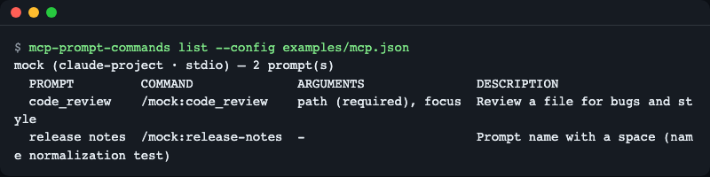
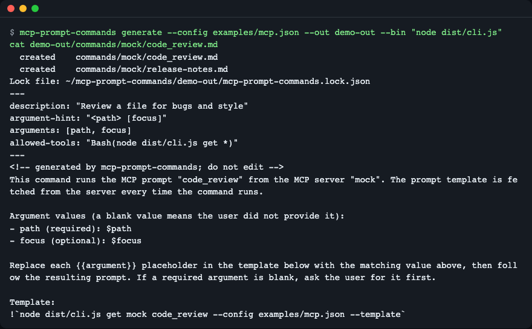
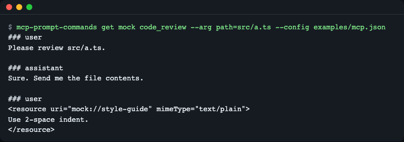
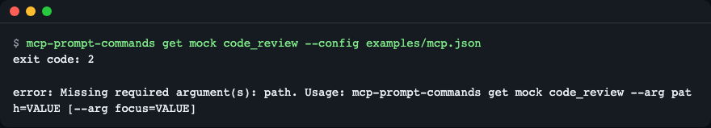
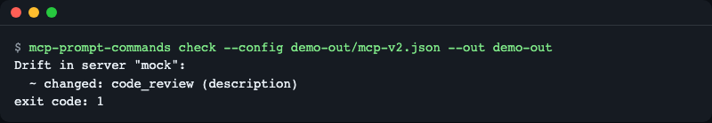
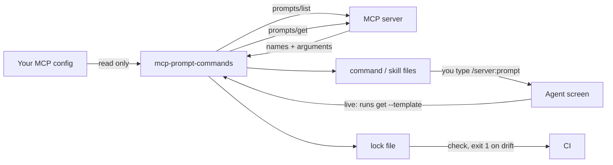

# mcp-prompt-commands

**English** | [한국어](README.ko.md)

Turn the prompts of your MCP servers into slash-command (or skill) files, so agent screens that do not show MCP prompts in their `/` menu can still run them. MCP servers can offer ready-made prompt templates (the "prompts" primitive); this CLI reads your existing MCP config, asks each server for its prompts, and writes one `/server:prompt` file per prompt, with a lock file and a CI drift check.


*`list` asks the server for its prompts and shows the slash command each one will get, with required arguments marked.*

## Who it is for

- You use Claude Code through the VS Code extension, the desktop app, WSL or a remote HTTP server, and the MCP prompts you see in a terminal are missing from the `/` menu there.
- You maintain an MCP server and want your prompts to be one keystroke away for your users, on any screen that reads command files.
- You want a CI check that fails when a server changes its prompts after you generated the command files.

## Install

Requires Node.js 20 or newer (`brew install node`, or see https://nodejs.org). On a minimal Linux image also install `git` and `ca-certificates`.

```bash
npm install -g mcp-prompt-commands      # then run: mcp-prompt-commands --help
npx mcp-prompt-commands list            # or run without installing
```

From a clone (this is the path the examples below were run with):

```bash
git clone https://github.com/LeeGyeongPil/mcp-prompt-commands.git
cd mcp-prompt-commands
npm ci && npm run build
node dist/cli.js --version
```
```text
0.1.1
```

`npx` starts a fresh Node process every time, which costs a few seconds on a cold cache. For the `live` mode below, a global install is recommended.

## Quick start (practice mock server)

The repository ships a **practice (mock) MCP server**. It is not a fake printer of text: it speaks the real MCP protocol over stdio, but it only serves two made-up prompts, so no account, key or network is needed. A real server differs in that it is your own server with your own prompts, and starting it may be slower (for example `npx`-based or remote servers).

```bash
npm ci && npm run demo
```
```text
Practice (mock) mode: using the bundled mock MCP server, not a real one.

$ mcp-prompt-commands list --config examples/mcp.json   # 1. which prompts does the server offer?
mock (claude-project · stdio) — 2 prompt(s)
  PROMPT         COMMAND              ARGUMENTS               DESCRIPTION
  code_review    /mock:code_review    path (required), focus  Review a file for bugs and style
  release notes  /mock:release-notes  -                       Prompt name with a space (name normalization test)

$ mcp-prompt-commands generate --config examples/mcp.json --out demo-out --bin "node dist/cli.js"   # 2. write one command file per prompt (live mode)
  created    commands/mock/code_review.md
  created    commands/mock/release-notes.md
Lock file: <repo>/demo-out/mcp-prompt-commands.lock.json
```

The demo goes on to print the generated file, render the prompt with `get`, and finish with `check` (`Checked 2 prompt(s) on 1 server(s): no drift.`). It takes about 3 seconds. The generated files are written to `demo-out/`, which is git-ignored. The demo's own captions are English; run `MCP_PROMPT_COMMANDS_LANG=ko npm run demo` to see the tool's output in Korean.

## Step by step

### 1. See what a server offers (`list`)


*Each row is one MCP prompt. `path (required)` means the server marked that argument as required.*

An MCP prompt has a name, an optional description and a list of arguments. The client asks with `prompts/list` and fetches one prompt with `prompts/get`. Large servers page the list; the tool follows every `nextCursor` page, so you get all of them.

### 2. Write the command files (`generate`)


*The server's argument definitions became the front matter of the command file: `argument-hint`, `arguments` and `allowed-tools`.*

Reading the file: the front matter declares the arguments, so the agent screen can ask for them. The body lists the values the user typed (`$path`, `$focus`) outside any shell line. The last line (`` !`…get mock code_review … --template` ``) fetches the current template from the server whenever the command runs. Note that **no user argument is ever placed on the shell line**, so a value such as `; rm -rf ~` cannot be executed; it stays plain text in the body.

Use `--dry-run` first to see what would be written without touching any file:

```bash
node dist/cli.js generate --config examples/mcp.json --out demo-out --bin "node dist/cli.js" --dry-run
```
```text
Dry run: nothing is written.
  unchanged  commands/mock/code_review.md
  unchanged  commands/mock/release-notes.md
```

(`unchanged` because the demo already wrote the same files. Without `--bin` the files would say `mcp-prompt-commands`, so they count as `updated`, and you get a warning if that command is not on your PATH.) To use the files, see "Use it with your own servers" below.

### 3. Fetch one prompt (`get`)


*The server's messages, split by role. The embedded resource (the style guide) is included as text.*

`get` is what the generated file runs. You can also run it by hand to check a prompt before you rely on it.

### 4. Required arguments are checked before the server starts


*The error appears immediately and the exit code is 2, so the server is never started for a bad call.*

An unknown prompt gives exit code 3 and the server's own message (`error: The server returned error -32602: Prompt nope not found`).

### 5. Catch drift (`check`)


*The server's description of `code_review` changed after `generate` (a copy of the mock server was edited between the two commands); `check` lists the change and exits with 1.*

## Use it with your own servers

Without `--config`, the tool reads the MCP configs you already have (see "Configuration"). Install it once with `npm install -g mcp-prompt-commands`, then, in your project folder:

1. See which servers and prompts were found:
   ```bash
   mcp-prompt-commands list
   ```
2. Write the files:
   ```bash
   mcp-prompt-commands generate
   ```
   Relative to the project folder, this writes:
   - `.claude/commands/<server>/<prompt>.md`: one command file per prompt (or `.claude/skills/<server>-<prompt>/SKILL.md` with `--format skills`; skill names are lowercased with `_` turned into `-` to follow the Agent Skills spec; the `SKILL.md` of an old underscore-named skill is deleted on the next `generate` if it is still the untouched generated file, edited ones are kept)
   - `.claude/mcp-prompt-commands.lock.json`: the lock file `check` compares against
3. Open the project in the agent screen and type `/<server>:<prompt>`, for example `/docs:code_review`. The screen asks for the declared arguments.

Option values that contain spaces must be quoted as one value, for example `--bin "node dist/cli.js"`. An unquoted value leaves stray words, and the tool stops with exit code 2 instead of writing broken files:

```bash
node dist/cli.js generate --config examples/mcp.json --out demo-out --bin node dist/cli.js   # wrong: no quotes
```
```text
error: "generate" does not take extra arguments, got: dist/cli.js. If they are part of --bin, quote the whole value: --bin "node dist/cli.js"
```

If you cannot install globally, pass the command the files should call: `--bin "npx -y mcp-prompt-commands@0.1.1"`. Every run then starts `npx`, so `live` commands are slower; use `--mode static` if that matters. Commit the generated files if the team should share them.

## CI drift check

`check` re-reads the prompts from the servers and compares them with the lock file. It exits with 1 when a prompt was added, removed or changed. A minimal GitHub Actions job:

```yaml
name: prompt-drift
on: [pull_request]
jobs:
  check:
    runs-on: ubuntu-latest
    steps:
      - uses: actions/checkout@v4
      - uses: actions/setup-node@v6
        with:
          node-version: 22
      - run: npx -y mcp-prompt-commands@0.1.1 check
```

This workflow is a template: the `check` command was run locally (step 5), but the workflow itself was not executed on GitHub. Prerequisites:

- Commit `.claude/mcp-prompt-commands.lock.json` (and the same `--out` folder, if you changed it; pass `--out` to `check` too).
- Commit the MCP config the servers are read from (`.mcp.json` or `.vscode/mcp.json`). A user-scope `~/.claude.json` does not exist on a CI runner.
- The servers must start in CI: their commands must be installed there and the environment variables they need (`${VAR}` in the config) must be set as job `env`. A server that cannot start makes `check` exit with 3, which also fails the job.

## Usage

| Command | What it does | Example |
|---|---|---|
| `list` | Show the servers found in your config and their prompts | `mcp-prompt-commands list` |
| `generate` | Write one command (or skill) file per prompt, plus the lock file | `mcp-prompt-commands generate --format skills` |
| `get <server> <prompt>` | Fetch one prompt and print it as Markdown | `mcp-prompt-commands get mock code_review --arg path=src/a.ts` |
| `check` | Compare the lock file with the servers; exit 1 on drift | `mcp-prompt-commands check` |

| Option | Meaning |
|---|---|
| `--config <file>` | Read this config instead of the default places (repeatable) |
| `--source claude,vscode,codex` | Limit the default places |
| `--server <name>` | Only these servers (repeat or comma-separate) |
| `--out <dir>` | Output folder (default `.claude`) |
| `--format commands\|skills` | `commands/<server>/<prompt>.md` (default) or `skills/<server>-<prompt>/SKILL.md` |
| `--mode live\|static\|agent` | See "Modes" below |
| `--bin <command>` | The command written into the files (default `mcp-prompt-commands`) |
| `--no-allowed-tools` | Do not write `allowed-tools` into the front matter |
| `--dry-run`, `--force` | Show only / overwrite files you edited by hand |
| `--arg name=value`, `--args-json`, `--args-line` | Argument values for `get` |
| `--template` | `get`: print `{{name}}` placeholders instead of values |
| `--timeout <ms>` | Connection timeout (default 10000, or `MCP_TIMEOUT`) |
| `--json`, `--verbose` | Machine-readable output / show server stderr |
| `--cwd`, `--home` | Project folder / home folder used to find configs |
| `--lang en\|ko` | Output language |

Exit codes: 0 success, 1 drift found, 2 usage error, 3 server error, 4 internal error.

## Modes

| Mode | What the file contains | Needs a shell at run time | Notes |
|---|---|---|---|
| `live` (default) | A `!` line that runs `get … --template` | Yes | Always the server's latest template. One `get` call costs about 0.39 s with the mock server (process and server start included); slower with `npx`-based or remote servers. |
| `static` | A snapshot of the prompt text with `$name` placeholders | No | Works where shell execution in skills is disabled. Run `generate` again to refresh. Server text that looks like shell or placeholders (`` !`…` ``, `$1`, `$ARGUMENTS`) is neutralised. |
| `agent` | Instructions telling the agent to run `get --arg …` itself | Yes (by the agent) | Used automatically, with a warning, if a server rejects the marker values used to build the template. |

Static output for `code_review`:

```text
---
description: "Review a file for bugs and style"
argument-hint: "<path> [focus]"
arguments: [path, focus]
---
<!-- generated by mcp-prompt-commands; do not edit -->
<!-- static snapshot of the MCP prompt "code_review" from the server "mock"; run `generate` again to refresh -->

### user
Please review $path focusing on $focus.

### assistant
Sure. Send me the file contents.

### user
<resource uri="mock://style-guide" mimeType="text/plain">
Use 2-space indent.
</resource>

Required arguments: path. If one is blank, ask the user for it before continuing.
```

## Configuration

The tool only **reads** the configs you already have and never writes to them.

| Source | Files | Notes |
|---|---|---|
| Claude Code | `.mcp.json`, and `~/.claude.json` (user and local scope) | local beats project beats user |
| VS Code | `.vscode/mcp.json` | `${input:id}` entries are skipped, with the reason shown |
| Codex | `config.toml` in `$CODEX_HOME` (default `~/.codex`) | |

Priority for the same server name: Claude local, Claude project, VS Code, Claude user, Codex. `${VAR}` and `${VAR:-default}` are expanded from your environment. stdio and Streamable HTTP servers are supported. Remote servers that need OAuth and servers without prompts are skipped with a reason in `list`. Values of env variables and headers are never printed.

| Environment variable | Meaning |
|---|---|
| `MCP_PROMPT_COMMANDS_LANG` | Output language, `en` or `ko` |
| `MCP_TIMEOUT` | Connection timeout in ms (same name Claude Code uses) |
| `CODEX_HOME` | Where the Codex `config.toml` lives |

Language: `--lang en|ko` first, then `MCP_PROMPT_COMMANDS_LANG`, then `LC_ALL`, `LC_MESSAGES`, `LANG`; anything that is not Korean falls back to English. The text inside generated files is English only, because a model reads it.

Safety on your files: a file without the "generated by" marker is never overwritten, even with `--force`. A generated file you edited by hand is overwritten only with `--force`. Files of prompts that disappeared are removed only if they carry the marker and were not edited.

## How it works



- The tool reads the server list from configs you already have (read only).
- It asks each server for its prompts with `prompts/list` and writes one file per prompt, plus a lock file with the definitions.
- When you type the command, the agent screen runs the `!` line in `live` mode; that calls `get`, which fetches the prompt with `prompts/get`.
- `check` replays `prompts/list` and compares it with the lock file for CI.

Security: the `!` line contains only `get <server> <prompt> --template`. Your typed values go into the body list, never into the shell. In Claude Code's documented behaviour the substitution runs once over the original file and values are inserted literally (https://code.claude.com/docs/en/slash-commands, checked 2026-11-17). `allowed-tools: Bash(<bin> get *)` lets the agent run the read-only `get` subcommand without asking; review it, or pass `--no-allowed-tools`.

## When to use it

- Good fit: the prompts exist on your MCP servers and the screen you work in does not list them, or you want them as plain files you can review and commit.
- Why this exists: reports that MCP prompts are missing from the VS Code extension, the desktop app and WSL are collected in Claude Code issues such as https://claudeissues.com/issue/66099-mcp-prompts-not-surfaced-in-claude-vs-code-extension-tools-work-fine and https://claudeissues.com/issue/75234-desktop-app-doesnt-surface-mcp-prompts-as-mcp-server-prompt-slash-commands-works (checked 2026-11-17 via search results).
- Other tools: [PromptLink](https://github.com/emdashcodes/prompt-link) is a VS Code extension that sends a prompt to the clipboard or a chat panel; it keeps its own server list and does not write command files. To expose upstream prompts to an agent as tools, see [mcp-prompt-bridge](https://www.npmjs.com/package/mcp-prompt-bridge); to call MCP servers by hand from a terminal, see [mcptools](https://github.com/f/mcptools). They solve different problems from writing command files.

## Limitations

- Not verified here: how a real Claude Code host orders the substitution of `$name` after running a `!` line. `live` does not depend on the order (the model fills `{{name}}` from the body list).
- SSE transport, OAuth servers, Codex prompt output and `--watch` are not implemented.
- Template building sends marker values as arguments. A prompt whose output is computed from the value, or a server that validates values strictly, falls back to `agent` mode.

## Troubleshooting

| Symptom | Cause | Fix |
|---|---|---|
| `error: Cannot read <path>: …` | A config file is unreadable or malformed | Fix it, or pass `--config <file>` / `--source vscode` to use another one |
| `error: "generate" does not take extra arguments, got: …` (exit 2) | An option value with spaces was not quoted | Quote the whole value: `--bin "node dist/cli.js"` |
| `list` shows a server as skipped | OAuth, `${input:id}`, or no prompts | Read the reason in the table; fix the config or ignore it |
| Exit code 3 on `generate` or `check` | A server could not start or returned an error | Run with `--verbose` to see its stderr; raise `--timeout` |
| `/server:prompt` does not appear | The file is not in the folder the screen reads | Generate into `.claude/commands` of the open project |
| `check` exits 1 | The server changed after `generate` | Review the listed changes and run `generate` again |

## Development

```bash
npm ci
npm test
```

Bugs and ideas are welcome as issues. Changes are recorded in [CHANGELOG.md](CHANGELOG.md).

## License

MIT. The practice server's prompt texts are written for this repository and use the same license.
